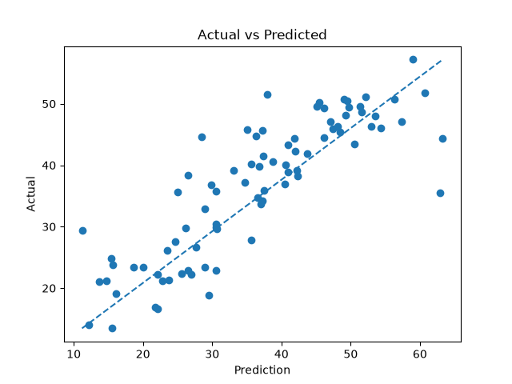
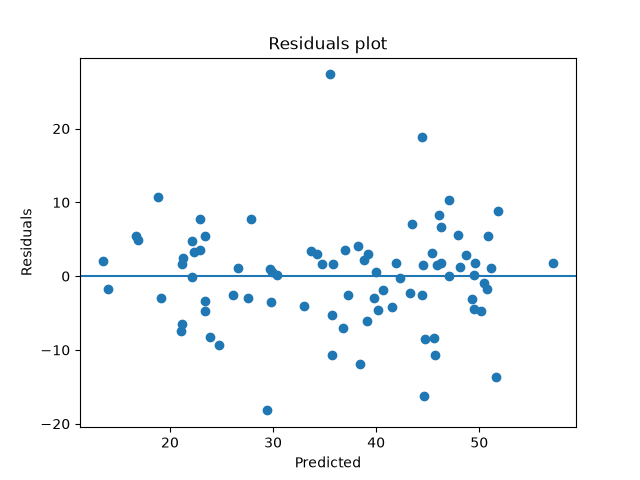

## Neural Networks Classification from scratch

This project implements Neural Networks Regression from scratch without relying on machine learing libraries for the core algorithm. This project validated by comparing it's performance with sckit learn `MLPRegressor` on Real estate Dataset.

## Features

* Neural Networks classification from scratch.
* intialize weights.
* ReLU function
* layer 1 prediction.
* convert hidden layer prediction into ReLU.
* ReLU output is output Layer input.
* backpropgation.
* find derivatives of hidden layer weights and output layer weights.
* update them.
* use those weights to predict test data.

## Dataset

`Real estate valuation data set.xlsx`

source:
UCI Machine Learning Repository

This dataset contains `8 features and 414 samples`.

## Algorithm

Neural Networks is suprvised learning algorithm. That uses interconnected neurons arranged in layers to learn patterns in data and predict target outputs by adjusting weights and bias through backpropgation.

## predictions

### Hidden layer
z1 = w1 * x + b1
a1 = ReLU(z1)
ReLU(z1) = max(0,z)

### output layer
z2 = w2 * a1 + b2
loss = 1/2((z2 - y)**2)


### Implementation

* Loaded the excel worksheet dataset.
* intialize hidden weights and outer weights.
* calculating hidden Layer .
* use convert hidden layer output into ReLU.
* Use the hidden layer ReLU output as output layer prediction input.
* will use output layer prediction as final prediction.
* find loss.
* backpropgation.
* find derivative of output layer weights and update weights.
* find derivative of hidden layer weights and update weights.
* use the weights to predict the test data.

## Results
### From scratch

```text
MAE: 4.56454139948124
MSE: 38.89303707916487
RMSE: 6.236428230899869
R2 Score: 0.769230731411069
```

### scikit learn

```text
MAE: 4.975166422821808
MSE: 46.620944823112914
RMSE: 6.827953194267877
R2 Score: 0.722096949083721
```
## Visualizations

## Actual vs Predicted



## Residual Plot



- Error > 0, model under predicted
- Error < 0, model over predicted
- Error = 0, model prediction was correct.
## Folder Structure

```text
Neural_Networks_regression/
│
├── plots/
│   ├── actual_vs_predicted.png
│   |__residual_plot.png
├── from_scratch.py
├── sklearn_model.py
├── visualization.py
└── README.md
```

### What I learned
* Learned Neural Networks implementation.
* Learned the difference between classification and regression implementations.
* Learned why using ReLU is useful.
* Learned how neural networks use neurons to predict.
* Learned how backpropagation effects the outputs mathmetically.
* Learned how two layer predictions will work.
* Learned why randomly intialized weights essential and how to intialize for layers.
* Learned to derive the mathmetics behind neural networks.